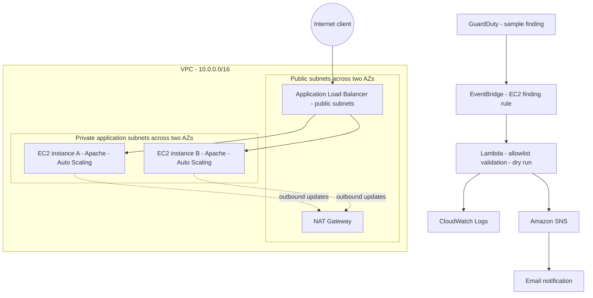

# BonTech Project 3 — Secure Cloud Infrastructure & Automated Threat Response

**Hands-on AWS cloud security engineering lab** | Region: `us-east-1` | Technical testing completed: November 8, 2026

## Project overview

Built and validated a two-Availability Zone AWS application environment with private EC2 instances, a public Application Load Balancer (ALB), Auto Scaling, and an automated detection-to-notification workflow. A GuardDuty-generated **sample EC2 finding** matched an EventBridge rule, invoked Lambda, and caused a safe allowlist-based rejection. CloudWatch recorded the execution, Amazon SNS published a security alert, and the email notification arrived.

**Scope:** Detection, validation, dry-run response decisions, logging, and alerting. **Live EC2 quarantine was not implemented or tested.**

## Architecture



Diagram source: [diagrams/architecture.mmd](diagrams/architecture.mmd)

## Implemented controls

- **Segmentation:** EC2 application instances run in private subnets without public IP addresses; public ALB distributes HTTP traffic.
- **Least-access networking:** Application security group permits inbound HTTP from the ALB's security group.
- **Availability:** Two instances managed by an Auto Scaling Group across two Availability Zones; replacement behavior validated by a controlled instance termination.
- **Administration:** EC2 Systems Manager role supports management without direct public SSH access.
- **Detection:** GuardDuty sample findings delivered through an EventBridge rule matching EC2 `Instance` findings.
- **Response validation:** Lambda checks instance IDs against an approved allowlist and checks VPC alignment for approved resources. The deployed function only simulates decisions.
- **Observability and alerts:** CloudWatch Logs capture invocation details; SNS sends email alerts for rejected containment requests.

## Evidence from verification tests

| Scenario | Verified observation |
|---|---|
| ALB access | HTTP application response received in prior browser/PowerShell tests |
| Auto Scaling recovery | ASG launched a replacement EC2 instance after controlled termination |
| Custom security simulation | EventBridge invoked Lambda successfully |
| GuardDuty sample finding | EC2 SSH brute-force sample finding requested with GuardDuty CLI |
| GuardDuty → EventBridge | EventBridge `Invocations` metric reported `Sum: 1.0` at 2026-11-08 19:32 UTC |
| EventBridge → Lambda | Lambda log recorded execution at 19:32 UTC |
| Lambda authorization | Synthetic `i-99999999` rejected with `approved: false`, `dry_run: true`, `CONTAINMENT_REJECTED` |
| SNS notification | CloudWatch logged successful SNS publication; email arrived at 2:32 PM ET |
| Live instance quarantine | **Not enabled; not tested** |

### Reproduction of the sample-finding request

```bash
DETECTOR_ID=$(aws guardduty list-detectors --region us-east-1 --query 'DetectorIds[0]' --output text)

aws guardduty create-sample-findings \
  --region us-east-1 \
  --detector-id "$DETECTOR_ID" \
  --finding-types "UnauthorizedAccess:EC2/SSHBruteForce"
```

To inspect recent Lambda logs:

```bash
aws logs tail "/aws/lambda/BonTech_Project3_Security_Containment" --since 30m --region us-east-1 --format short
```

*The sample finding is synthetic and does not indicate that a real EC2 instance was attacked.*

## Security limitations and lessons learned

1. This test confirms automated **detection-to-notification** behavior, not a real attacker or production incident.
2. No security-group changes are performed. `DRY_RUN=true` is set, and the deployed function does not call an EC2 modification API.
3. Before a production response, validate finding origin, account and region, freshness, severity, instance state/tags, and authorization with stronger guardrails.
4. Direct quarantine of an ASG-managed instance can fail ALB health checks and cause ASG replacement, risking loss of forensic evidence. A production design must account for incident preservation and ASG behavior.
5. Documentation deliberately omits AWS account numbers, email addresses, credentials, and raw subscription links.

## Engineering documentation

- [Architecture and data flows](docs/architecture.md)
- [Security controls and limitations](docs/security-controls.md)
- [STRIDE-inspired threat model](docs/threat-model.md)
- [Incident-response runbook](docs/incident-response-runbook.md)
- [Validation matrix and acceptance criteria](docs/validation-matrix.md)
- [Test evidence](docs/test-evidence.md)
- [AWS cost drivers and safe teardown](docs/cost-and-operations.md)
- [Interview preparation and resume bullets](docs/interview-and-resume.md)
- [Screenshot sanitization guide](screenshots/README.md)

## Portfolio description

Developed a multi-AZ AWS cloud security lab integrating VPC segmentation, private EC2, ALB, Auto Scaling, GuardDuty, EventBridge, Lambda, CloudWatch, and SNS. Verified a GuardDuty-generated sample finding triggered Lambda's simulated authorization rejection and delivered an SNS email alert.

## Repository organization

- `README.md` — architecture, implementation overview, verified outcomes, and limitations
- `diagrams/architecture.mmd` — Mermaid architecture source
- `docs/` — engineering notes and sanitized test evidence (to be added)
- `screenshots/` — selected redacted evidence (to be added)

**Never commit AWS access keys, account identifiers, personal email addresses, SNS unsubscribe links, or unredacted security console screenshots.**
