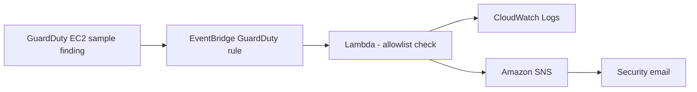

# AWS Architecture and Request Flow

## Scope

BonTech Project 3 is a hands-on AWS cloud security lab in the `us-east-1` region. This is a documented implementation and test environment, not a claim of production deployment.

## Network architecture

| Layer | Implementation | Security rationale |
|---|---|---|
| VPC | Dedicated IPv4 VPC, `10.0.0.0/16` | Isolate the application network |
| Public subnets | Across two Availability Zones | Host the internet-facing Application Load Balancer |
| Private subnets | Across two Availability Zones | Host application EC2 instances without public IP addresses |
| Internet access | Internet gateway for public resources; NAT gateway for private outbound traffic | Restrict inbound exposure while allowing outbound updates |
| Load balancing | Application Load Balancer on HTTP/80 | Route traffic to healthy private targets |
| Compute | Apache on `t3.micro` EC2 instances managed by Auto Scaling | Demonstrate availability and replacement |
| Management | Systems Manager instance role | Avoid requiring direct public SSH access |

### Application traffic

1. Internet client sends HTTP request to the public ALB.
2. The ALB forwards traffic to healthy EC2 targets in private subnets.
3. The application security group only permits inbound application HTTP traffic from the ALB security group.
4. If an instance fails and is replaced, the Auto Scaling Group launches a replacement based on its launch template.
5. Private instances use the NAT gateway for permitted outbound access.

The architecture is **not** represented as having HTTPS termination or a production-grade web application firewall policy unless those specific configurations are separately verified.

## Detection and response flow



### Filtering

The GuardDuty rule matches events with:

```json
{
  "source": ["aws.guardduty"],
  "detail-type": ["GuardDuty Finding"],
  "detail": {
    "resource": {
      "resourceType": ["Instance"]
    }
  }
}
```

### Lambda guardrails and scope

- Extract the instance ID from a supported incoming event structure.
- Reject instance IDs that are not on the approved list.
- For approved IDs, describe the EC2 instance and quarantine security group and check VPC compatibility.
- Record the result to CloudWatch.
- Publish an SNS alert on a rejected containment request.
- Keep `DRY_RUN=true`. The deployed code is simulation-only and does **not** modify EC2 security groups.

The sample finding referenced a synthetic instance ID. Its rejection was expected and does not imply that a real machine was quarantined.

## Availability and incident-response considerations

An Auto Scaling Group may replace an instance that fails application health checks. Changing an ASG-managed EC2 security group to a quarantine group could interrupt ALB health checks and cause automatic termination. A real containment design should separately handle evidence collection, lifecycle controls, and approval before modifying network access.

## Diagram source

See [../diagrams/architecture.mmd](../diagrams/architecture.mmd).
